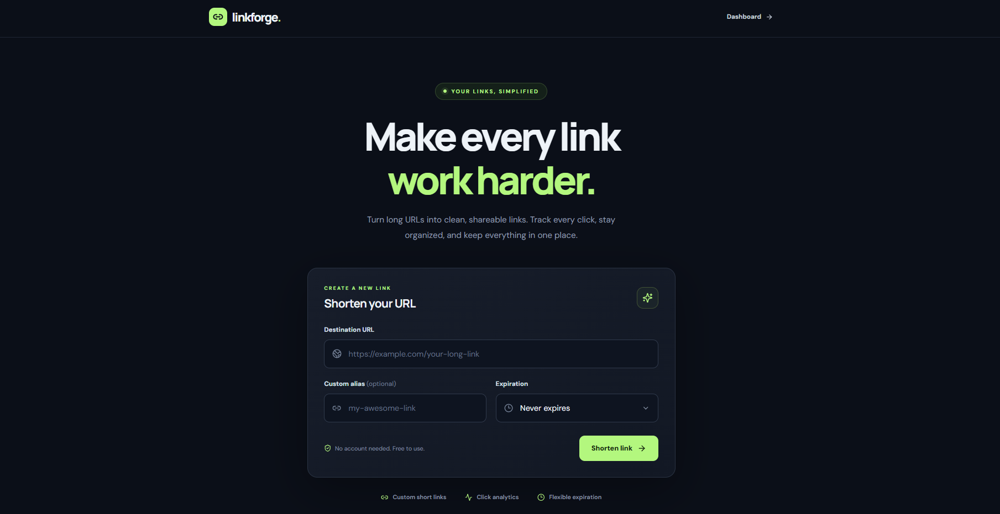
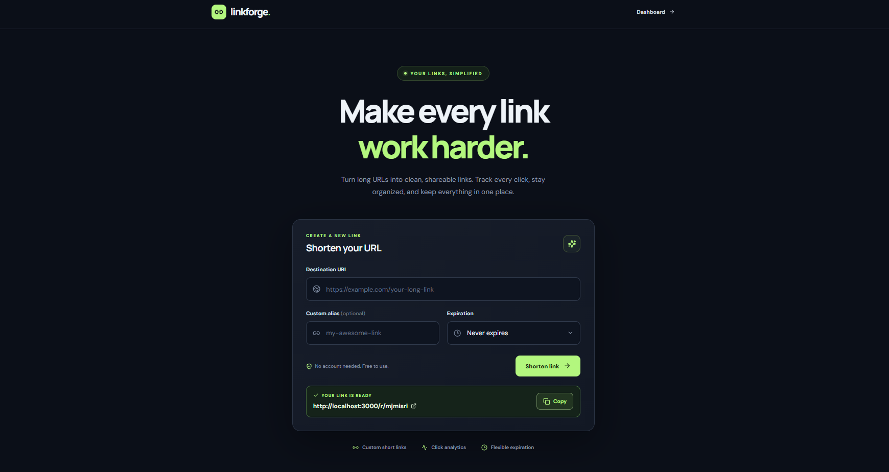
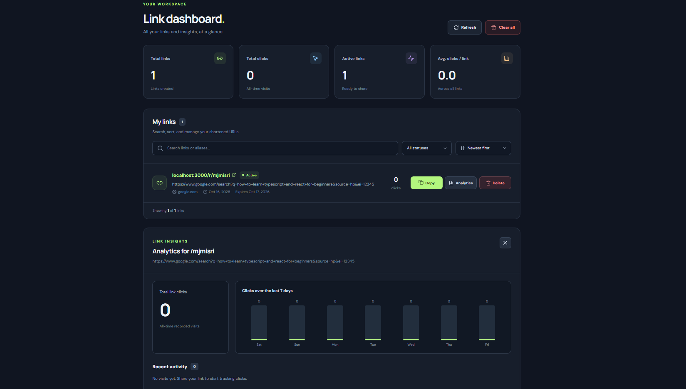

# LinkForge

**Short links. Clear insights.**

LinkForge is a full-stack URL shortener with a responsive dashboard for creating, managing, and tracking shortened links. It supports custom aliases, expiration dates, and click analytics, with no external API keys required for local use.


## Preview

### Search and Filter


### URL Shortener
Enter a long URL, choose an optional custom alias, and generate a short link.



### Dashboard and Analytics
Manage shortened links, track clicks, and view analytics.




## Features

- **URL shortening:** Turn long URLs into shareable short links.
- **Custom aliases:** Choose a memorable short code when available.
- **Link expiration:** Set links to expire after 1, 7, or 30 days, or never.
- **Click analytics:** See total clicks, recent visits, referral information, and a 7-day activity chart.
- **Link management:** Search, filter, sort, copy, and delete links.
- **Dashboard overview:** View link counts and engagement at a glance.
- **Responsive layout:** Use the dashboard on desktop and smaller screens.
- **Local persistence:** Save link records and click history to a JSON file on the server.

## Tech stack

| Layer | Technologies |
| --- | --- |
| Frontend | React, TypeScript, Vite |
| UI | CSS, Lucide React |
| Backend | Node.js, Express, TypeScript |
| Storage | Local JSON file (`server/data/links.json`) |

## Getting started

### Prerequisites

- Node.js 20.19+ or 22.12+
- npm

### Installation

1. Clone the repository:

   ```bash
   git clone https://github.com/YOUR_USERNAME/YOUR_REPOSITORY.git
   cd YOUR_REPOSITORY
   ```

2. Install dependencies:

   ```bash
   npm --prefix client install
   npm --prefix server install
   ```

3. Start the frontend and backend together:

   ```bash
   npm run dev
   ```

4. Open **http://localhost:5173** in your browser.

**Windows PowerShell:** If `npm` is blocked by your execution policy, use `npm.cmd` instead, for example `npm.cmd run dev`.

The frontend runs at `http://localhost:5173`, and the backend runs at `http://localhost:3000`. During development, Vite proxies `/api` and `/r` requests to the backend.

## How it works

1. Enter a long URL and optionally choose a custom alias and expiration date.
2. LinkForge creates a short URL using the backend API.
3. Opening the short URL redirects to the destination and records a click.
4. The dashboard displays saved links and analytics.

## Project structure

```text
linkforge-complete/
├── client/
│   └── src/           # React components and styling
├── server/
│   └── src/           # Express API, redirects, and storage
├── scripts/
│   └── dev.mjs        # Starts both development servers
├── .gitignore
├── package.json
└── README.md
```

## Available commands

Run these from the project root:

| Command | Purpose |
| --- | --- |
| `npm run dev` | Start frontend and backend for development |
| `npm run check` | Run TypeScript checks |
| `npm run build` | Build the frontend |
| `npm run start` | Start the backend |

## Current limitations

LinkForge is intended for local development and portfolio demonstrations. It does **not** include user accounts or authentication. Anyone who can access the API may be able to manage or delete stored links. JSON storage is intended for a single server process and is not designed for concurrent, multi-user production workloads.

Before public deployment, add authentication, rate limiting, abuse prevention, and a production-ready database. Set `PUBLIC_BASE_URL` to the publicly accessible backend origin so generated short links resolve correctly.

## License

This project is licensed under the MIT License.
See the [LICENSE](LICENSE) file for details.
